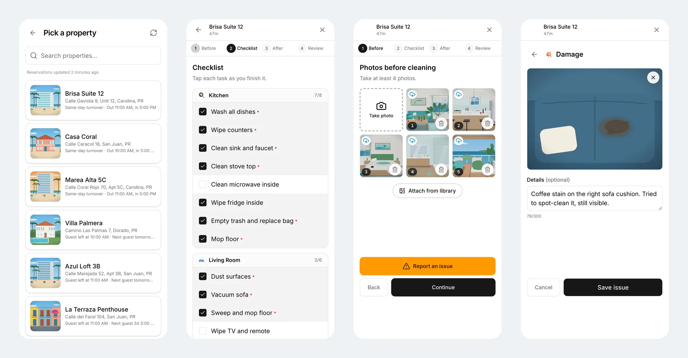
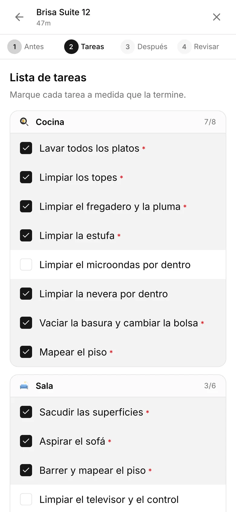
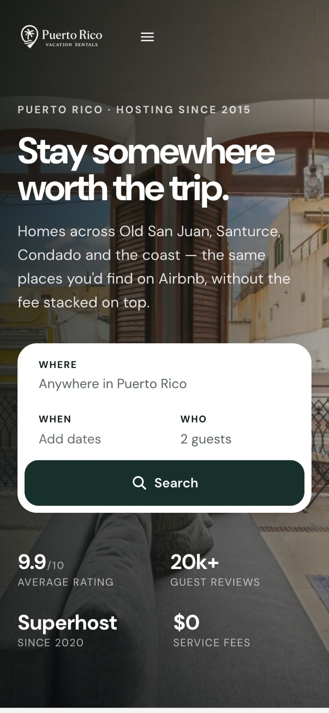
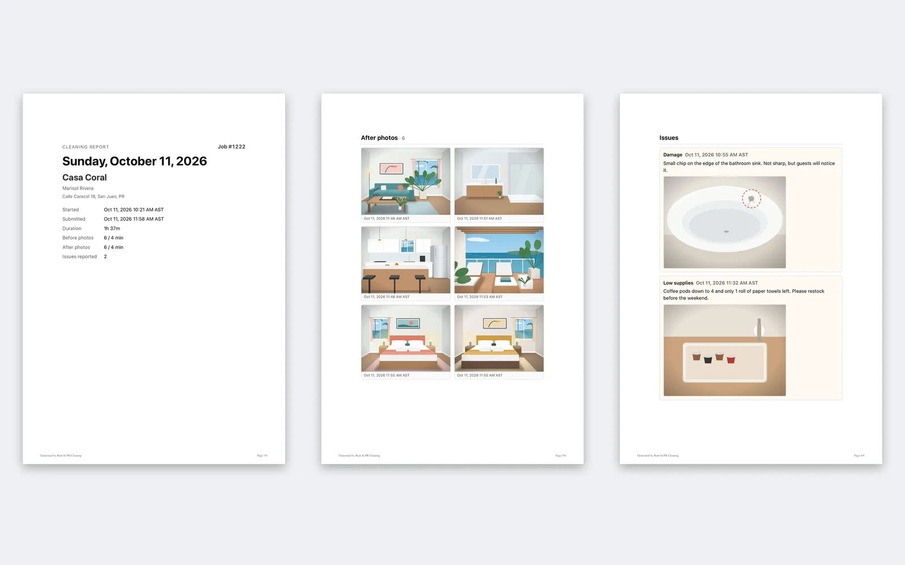
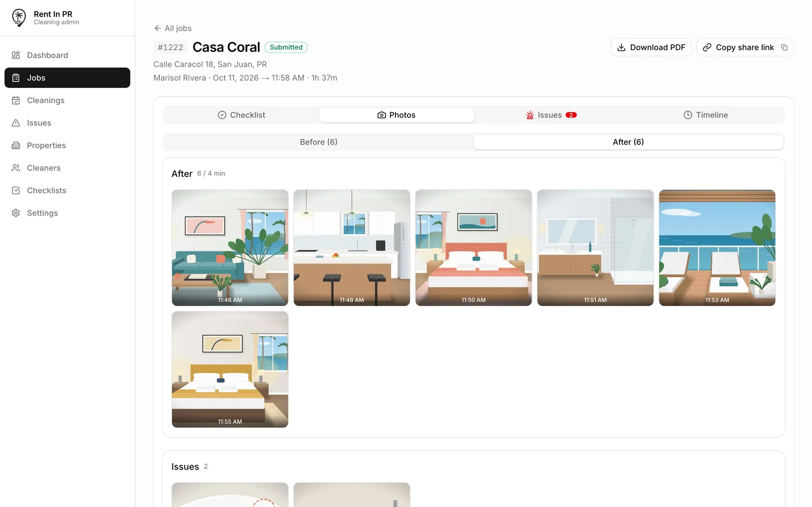

# Palm Heaven: pricing, CleanerProof and direct booking

**I designed the platforms a vacation rental company with 100+ homes runs on, giving its cleaning crews back 5,400+ hours a year and putting $225K+ a year back into a $1.44M business.**

| Role | Platform | Live |
|:--|:--|:--|
| Head of Product & Operations | Crew phone app in English and Spanish, manager console, the RentInPR.com direct-booking platform | [RentInPR.com](https://rentinpr.com) · [Full case study](https://bardia.dev/work/palm-heaven.html) |

## The problem
The company took in $1.44M of guest payments a year across 2,541 bookings, and it ran on memory and text messages. Cleaners worked from verbal instructions, so when a guest claimed damage there was no proof. Over 100 pricing settings had never been set, and direct-booking visitors hit a dead end and left for the platforms that take a cut.

## What I designed
- **CleanerProof**, a one-handed crew app built for a cheap Android phone in weak Wi-Fi, in English and Spanish: step-by-step checklists, required photos and an automatic proof report for every turnover.
- **Profit-first pricing**: rules that show the old and new price, the reason and the downside, then wait for a person's approval.
- **RentInPR.com**, a direct-booking platform built from scratch: live availability, the all-in price up front, and none of the 15 to 20% platform fees.

<table><tr>
<td width="33%"></td>
<td width="33%"></td>
<td width="33%"></td>
</tr></table>

## Results
- **5,400+ crew hours a year** saved by CleanerProof
- **2,000+ turnovers a year** with photo proof
- **$110K a year** in added nightly revenue from profit-first pricing (6 to 9% year over year)
- **$20K+ a year** in booking-platform fees avoided through direct booking
- **4.5 to 4.8** guest cleanliness rating across every listing

> **About the code:** this platform is private business software, so this repository holds the case study only: screens, decisions and results. Every screenshot shows the real product running on made-up demo data.

[Bardia Zadeh](https://bardia.dev) · Georgia Tech M.S. in Computer Science (HCI)
